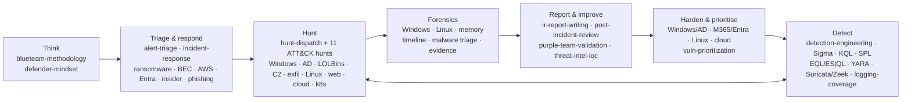

# Claude-BlueTeam

> A Claude Code skill bundle for defenders · **45 skills** · **16 slash commands** · **5 subagents** · case-folder scaffolder ·
> SOC triage, incident response, detection engineering, ATT&CK-mapped threat hunting, DFIR, hardening,
> vulnerability prioritisation, threat intel and reporting.

The defensive counterpart of offensive bundles like
[Claude-BugHunter](https://github.com/elementalsouls/Claude-BugHunter): same idea (skills that auto-load by topic,
slash commands that run a whole procedure, hard evidence gates), pointed the other way. Install it and Claude Code
works like a senior SOC / DFIR analyst: it asks for the right telemetry, writes the query for your SIEM, keeps a UTC
timeline, refuses to call a verdict without evidence, and never runs a containment action without your approval.

---

## Quickstart

**Option A — plugin (recommended).** Inside Claude Code:

```text
/plugin marketplace add Bizaza-devs/Claude-BlueTeam
/plugin install blueteam@bizaza-devs
```

Skills, commands and agents load namespaced under `blueteam:` and update with the plugin version.

**Option B — copy install.**

```bash
git clone https://github.com/Bizaza-devs/Claude-BlueTeam.git
cd Claude-BlueTeam
bash scripts/install.sh            # macOS / Linux
pwsh ./scripts/install.ps1         # Windows
```

Copies skills, commands and agents into `~/.claude/` (replaced items are backed up first; `--uninstall` / `-Uninstall`
removes exactly what was installed).

Then describe the situation in plain language — the right skills load on their own:

```text
> Defender flagged rundll32 loading a DLL from C:\Users\Public on FIN-WS-17. Triage it.

  ⟳ loading skills: alert-triage, hunt-lolbins, kql-sentinel-defender …
    → gate: process tree, signer, prevalence, network, user context
    → KQL: parent chain + DLL first-seen + outbound connections (last 7d)
    → verdict: needs-data — DLL unsigned, first seen org-wide 14:02 UTC, beaconing pattern to 1 host
    → next: /investigate host FIN-WS-17   ·   escalate to /ir if C2 confirmed
```

---

## How it is organised



Every skill follows the same shape (see [CONTRIBUTING.md](CONTRIBUTING.md)): **When to use → Ground rules (the evidence
gate) → Workflow → domain sections (queries, artifacts, decision tables) → False positives → Pitfalls → Output → References.**

### Skills

| Layer | Skills |
|---|---|
| **Think** | `blueteam-methodology` (NIST SP 800-61r3 / PICERL operating model, severity, cadence) · `defender-mindset` (hypotheses, ACH, Pyramid of Pain, bias, confidence language) |
| **Triage & respond** | `alert-triage` · `incident-response` · `ir-ransomware` · `ir-bec-m365` · `ir-cloud-aws` · `ir-azure-entra` · `ir-insider-threat` · `phishing-analysis` |
| **Detect** | `detection-engineering` · `sigma-rules` · `kql-sentinel-defender` · `spl-splunk` · `elastic-eql-esql` · `yara-rules` · `network-detection-suricata-zeek` · `logging-coverage` |
| **Hunt — Windows / identity** | `hunt-dispatch` · `hunt-windows-persistence` · `hunt-lateral-movement` · `hunt-credential-access` · `hunt-ad-identity-attacks` · `hunt-lolbins` |
| **Hunt — network / Linux / cloud** | `hunt-c2-beaconing` · `hunt-exfiltration` · `hunt-linux-persistence` · `hunt-webshells` · `hunt-cloud-control-plane` · `hunt-k8s-runtime` |
| **Forensics** | `windows-forensics` · `linux-forensics` · `memory-forensics` · `timeline-analysis` · `malware-triage` · `evidence-handling` |
| **Harden & prioritise** | `hardening-windows-ad` · `hardening-m365-entra` · `hardening-linux` · `hardening-cloud` · `vuln-prioritization` |
| **Intel, validate, report** | `threat-intel-ioc` · `purple-team-validation` · `ir-report-writing` · `post-incident-review` |

### Slash commands

| Command | What it does |
|---|---|
| `/triage <alert>` | Fast evidence-gated verdict: TP / benign TP / FP / needs data / escalate |
| `/investigate <entity>` | Structured deep-dive on a user, host, IP, domain or hash |
| `/ir <name>` | Opens a case folder and walks the IR lifecycle |
| `/contain <target>` | Containment plan with blast radius, reversibility and an approval gate |
| `/hunt <hypothesis>` | Hypothesis-driven hunt routed through `hunt-dispatch` |
| `/detect <behaviour>` | Behaviour → tested, tuned detection for your SIEM |
| `/sigma <behaviour or rule>` | Write, review or convert a Sigma rule |
| `/phish <email>` | Header / URL / attachment analysis, purge and notify plan |
| `/ioc <text>` | Extract, defang, enrich and pivot on indicators |
| `/forensics <host or image>` | Artifact-driven host triage |
| `/timeline` | Super-timeline / incident timeline in UTC |
| `/harden <system or tenant>` | Prioritised hardening review |
| `/coverage` | ATT&CK coverage gaps + Navigator layer JSON |
| `/purple <technique>` | Detection-validation exercise plan |
| `/report` | Incident report (executive + technical) |
| `/postmortem` | Blameless post-incident review |

### Subagents

`soc-analyst` · `incident-commander` · `detection-engineer` · `threat-hunter` · `forensic-analyst` — Claude Code can
hand a whole strand of work to one of them (e.g. *"have the forensic-analyst go through this KAPE collection"*).

### Case folders

`/ir` runs the scaffolder and keeps everything for an incident in one place:

```text
cases/2026-11-25-ransomware-fs01/
├── notes.md          summary, scope, hypotheses, working notes
├── timeline.csv      timestamp_utc,host,source,event,detail,analyst,confidence
├── iocs.csv          type,value_defanged,first_seen_utc,last_seen_utc,source,confidence,tlp,notes
├── evidence-log.csv  chain of custody with SHA-256
├── actions.md        every containment action with blast radius + approver
├── report.md         report skeleton for /report
└── evidence/
```

```powershell
.\scripts\new-case.ps1 -Name ransomware-fs01 -Severity SEV1
```

```bash
scripts/new-case.sh ransomware-fs01
```

`cases/` is git-ignored except for its README — case data never lands in a repository.

---

## Ground rules the bundle enforces

- **No verdict without evidence.** Single-source alerts are corroborated before a true-positive call; "nothing found"
  is reported with the data sources and time range it covers.
- **Humans approve containment.** Isolation, account disables, blocks and purges are proposed with blast radius and
  rollback, and only run after an explicit yes.
- **Preserve before you change.** Memory and volatile data first, hashes at acquisition, chain of custody in the case.
- **UTC everywhere**, IOCs defanged, TLP respected, confidential samples kept out of public sandboxes.
- **Defensive scope.** Malware content is analysis-only; purple-team content runs published test procedures in a lab
  or under change approval to validate detections.

Queries are written against documented schemas (Defender XDR / Sentinel tables, Splunk CIM, ECS, CloudTrail,
Sysmon, Windows Security events) and say where they need local tuning — treat them as strong starting points, test
them against your own data before you rely on them.

---

## Development

```bash
python scripts/lint_skills.py        # frontmatter, names, required sections, cross-references, catalogue
```

CI runs the linter, validates the plugin manifests and smoke-tests the case scaffolder on every push.
New skills: read [CONTRIBUTING.md](CONTRIBUTING.md) first — it is the authoring guide and the catalogue.

## Magyarul röviden

Védekező (blue team) skill-csomag a Claude Code-hoz: riasztás-triázs, incidenskezelés, detekciófejlesztés
(Sigma/KQL/SPL/YARA), ATT&CK-alapú fenyegetésvadászat, forenzika, hardening, sérülékenység-priorizálás és
jelentésírás. Telepítés: `/plugin marketplace add Bizaza-devs/Claude-BlueTeam`, majd
`/plugin install blueteam@bizaza-devs`. Kezdésnek: `/triage`, `/ir`, `/hunt`, `/detect`.

## License

MIT — see [LICENSE](LICENSE). Inspired by the structure of Claude-BugHunter (MIT); no content was copied from it.
